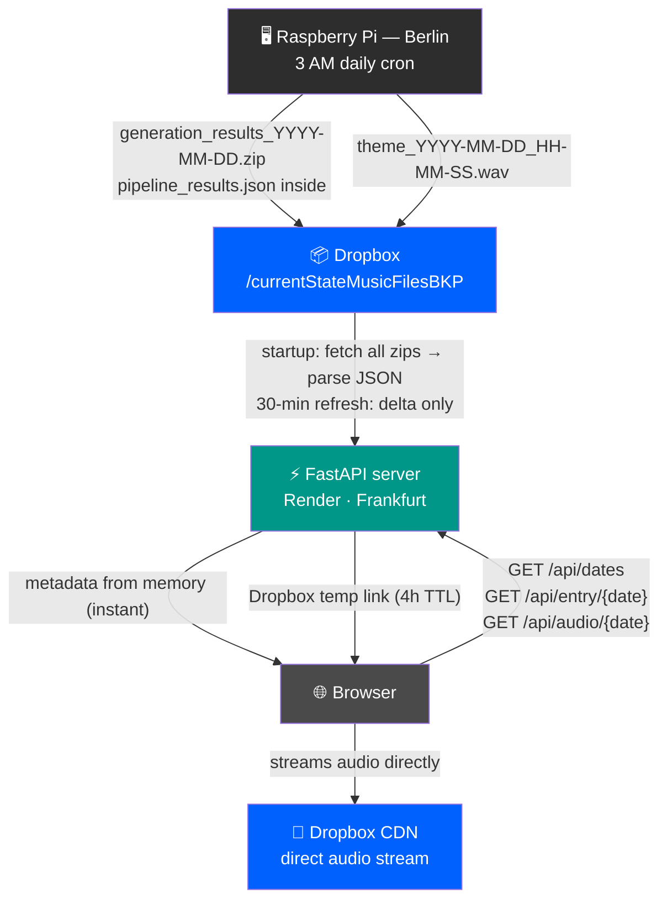
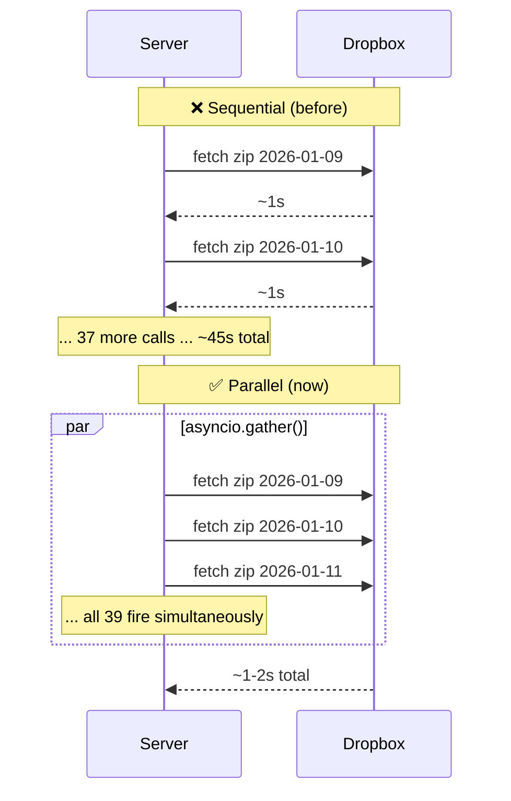
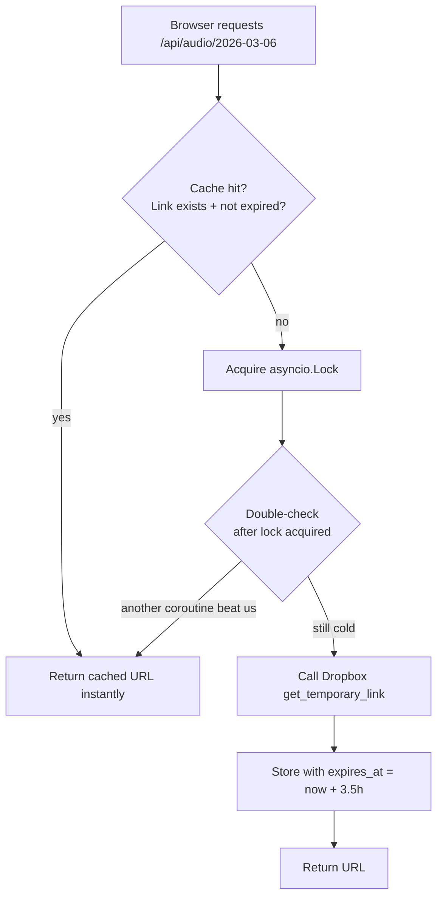
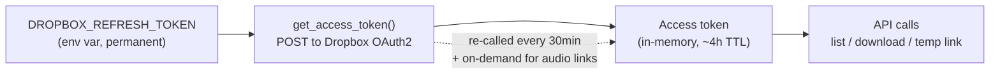
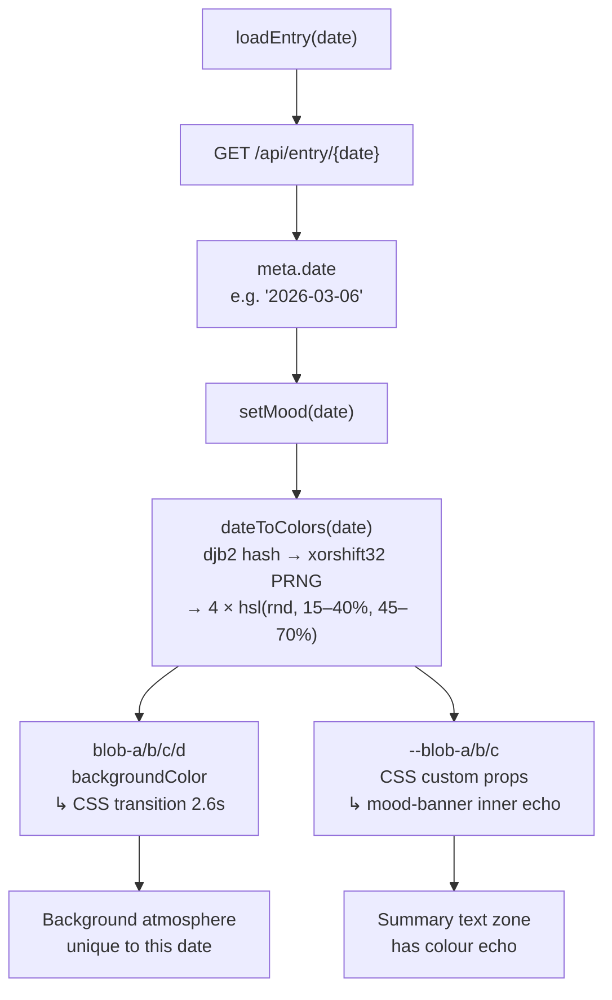

# current_state browser

[](https://current-state-browser.onrender.com/)

<div align="center">

**A slow archive. A temporal journal. A radio that only plays the past.**

[](https://current-state-browser.onrender.com)
[](https://www.python.org/)
[](https://fastapi.tiangolo.com/)
[](https://render.com)
[](https://www.dropbox.com/)
[](https://docs.astral.sh/uv/)

*Part of the [current_state](https://github.com/dattasaurabh82/current_state) project by [Saurabh Datta](https://www.dattasaurabh.com)*

</div>

---

## What is this?

Every day, a Raspberry Pi in Berlin wakes up at 3 AM, reads the news, runs it through an LLM pipeline that analyses the emotional weight of the day — the tension, the hope, the themes — and generates a piece of ambient music from that analysis. Not music *about* the news. Music *from* it. There's a difference.

This browser is how you get to that archive. Pick a date, read what the system felt about that day, and listen to the music it made. The background of the page shifts to a colour atmosphere unique to that date. It's subtle — the whole thing is designed to be slow and quiet, like the music itself.

Think of it less like a music player and more like a **temporal journal that happens to have audio**. The date picker is the main navigation. You're navigating through time, not a playlist.

> **Live:** [current-state-browser.onrender.com](https://current-state-browser.onrender.com)

---

## How the whole thing fits together

This is the part worth understanding before anything else. There are three systems involved, and the way they're connected determines basically every architectural decision in this codebase.



The key thing to notice: **the server is never in the audio data path.** The browser gets a Dropbox temporary link from the API and streams the `.wav` directly from Dropbox's CDN. No audio bytes ever touch the FastAPI server. This means the server can be tiny (Render Starter, $7/mo) and handle any number of simultaneous listeners without bandwidth issues.

---

## Project structure

```
current_state_browser/
│
├── main.py                    # FastAPI app — routes, lifespan, static serving
│
├── lib/
│   ├── __init__.py
│   ├── dropbox_client.py      # Dropbox OAuth2, file listing, zip fetch, temp links
│   └── cache.py               # In-memory cache — startup fetch, background refresh, audio TTL
│
├── static/
│   ├── index.html             # Single-page UI — frosted card, blob background
│   ├── css/style.css          # Design system — tokens, card, blobs, mood zones
│   └── js/app.js              # API calls, date-seeded colours, blob animation, waveform
│
├── context/                   # Internal session docs (not shipped, not relevant to users)
│   ├── session_01_context.md
│   ├── session_02_context.md
│   ├── mood_system_mechanics.md
│   ├── caching_architecture.md
│   └── future_work.md
│
├── tests/
│   ├── test_step1.py          # Dropbox auth + listing
│   └── test_step2.py          # Cache load + metadata fetch
│
├── render.yaml                # Render config reference (not auto-applied in dashboard flow)
├── pyproject.toml
├── uv.lock
├── .env.example
└── .env                       # ← gitignored, never commit
```

---

## API reference

The server exposes a dead-simple read-only JSON API. No auth, no rate limiting, no pagination needed at current scale.

| Method | Endpoint | Returns | Notes |
|--------|----------|---------|-------|
| `GET` | `/` | HTML | Serves `static/index.html` |
| `GET` | `/api/dates` | `{ dates: [...], count: N }` | All complete dates, ascending |
| `GET` | `/api/entry/{date}` | Metadata JSON | See schema below |
| `GET` | `/api/audio/{date}` | `{ url: "...", date: "..." }` | Dropbox temp link, valid 4h |
| `GET` | `/api/status` | Cache health | `dates_loaded`, `last_refresh`, `audio_links_cached` |
| `GET` | `/docs` | Swagger UI | FastAPI auto-docs |

### Entry metadata schema

```json
{
  "date": "2026-03-06",
  "summary": "A day marked by political instability and unexpected cultural moments.",
  "dominant_themes": ["politics", "technology", "culture"],
  "energy_level": "medium",
  "tension_level": 0.62,
  "hope_factor": 0.38,
  "primary_archetype": "gentle_tension",
  "prompt_natural": "A slow, unresolved ambient piece with muted strings and subtle dissonance at 68 BPM."
}
```

> **`tension_level` and `hope_factor`** are floats 0–1 from the LLM pipeline. The UI multiplies them by 100 for display. They don't sum to 1 — they're independent scores.

> **`primary_archetype`** is displayed as a label in the UI but does **not** drive the visual colour system. See [The Mood System](#the-mood-system) below.

---

## Architecture: caching

This is the most interesting part of the backend, so it's worth explaining in detail.

### Why in-memory? Why not a database?

Short answer: the data is append-only, read-heavy, and tiny. Each date's metadata is ~1–2KB of JSON. The full archive at 1 year is ~500KB. At 10 years it's ~5MB. Render Starter has 512MB RAM. A database would mean a migration story, a connection pool, a separate service, and a monthly cost — for data that fits comfortably in a Python dict. In-memory wins here by a lot.

### Startup: why we parallelise zip fetches

When the server starts, it needs to fetch the metadata for every date in the archive. Each date's metadata lives inside a `.zip` file on Dropbox. Fetching one zip = one HTTP request = ~1 second.

The original sequential approach:

```python
# ❌ Sequential — slow
for date in sorted(new_dates):
    raw = fetch_and_parse_zip(token, zip_path)
    ...
# 39 dates × ~1s = ~45 seconds cold start
```

The problem is obvious. At 1 year that's 6 minutes. The fix is equally obvious:

```python
# ✅ Parallel — fast
tasks = [_fetch_one_date(token, date, zip_path) for date in sorted(new_dates)]
results = await asyncio.gather(*tasks)
# All 39 calls fire simultaneously → ~3-5 seconds total, always
```

The reason this scales permanently is that Dropbox API latency (~1s) is the bottleneck, not CPU. When you fire 365 calls in parallel, the total time is `max(individual times)` ≈ 1–2s, not `sum(individual times)` = 6 minutes.



Each individual fetch runs in a thread pool via `asyncio.to_thread()` so it doesn't block the event loop. And errors are isolated per-task — if one zip fails to parse, the rest continue and that date just gets excluded from the live map.

### Background refresh: why it stays fast forever

Every 30 minutes, the server re-lists Dropbox and looks for new dates:

```python
new_dates = set(date_map.keys()) - set(self._metadata.keys())
```

After first startup, `new_dates` is almost always `0` (no new entry yet) or `1` (today's). The parallel fetch of 0–1 items is instantaneous. Archive size is irrelevant — it's always a delta.

### Audio links: on-demand TTL cache

Dropbox temporary links expire after 4 hours. We don't pre-generate them for all dates at startup — most dates won't be visited in any given window, and 39+ links expiring simultaneously would create a thundering herd problem. Instead:



TTL is **3.5h not 4h** — that 30-minute buffer ensures a link cached just before expiry doesn't go stale mid-session. The `asyncio.Lock` prevents N concurrent users hitting the same cold date from triggering N simultaneous Dropbox calls. One call fires; the rest wait, then hit the cache.

### Memory scaling at a glance

| Timeline | Dates | Metadata | Audio link cache |
|----------|-------|----------|-----------------|
| Now | ~39 | ~60 KB | ~10 KB |
| 1 year | 365 | ~500 KB | ~90 KB |
| 5 years | 1,825 | ~2.5 MB | ~450 KB |
| 10 years | 3,650 | ~5 MB | ~900 MB |

Render Starter has 512 MB RAM. Memory is not a scaling concern for the lifetime of this project.

---

## Architecture: Dropbox integration

### File naming conventions

The Pi uploads two files per day into `/currentStateMusicFilesBKP`:

| File | Pattern | Example |
|------|---------|---------|
| Metadata zip | `generation_results_YYYY-MM-DD.zip` | `generation_results_2026-03-06.zip` |
| Audio | `<theme>_YYYY-MM-DD_HH-MM-SS.wav` | `world_theme_2026-03-06_03-01-07.wav` |

A date is only considered "complete" (and served) if **both** files are present. Incomplete dates — where only one of the two uploaded successfully — are silently excluded. The UI shows "No entry available" for those dates.

### What's in the zip

```
generation_results_YYYY-MM-DD.zip
├── pipeline_results.json    ← the one we care about
├── prompt.txt               ← raw prompt text (not used in UI)
└── visualizations/          ← SVG charts (not used in UI)
```

`pipeline_results.json` is parsed in memory — the zip is downloaded as bytes, extracted with `zipfile.ZipFile(io.BytesIO(...))`, and the JSON is parsed. Nothing is written to disk.

### Token lifecycle



The refresh token lives in Render env vars. The access token lives in `AppCache._token`. The server never writes credentials to disk. Rotating the refresh token (if needed) is a dashboard env var change + redeploy.

---

## The mood system

This is the bit that makes the UI feel alive. When you pick a date, the background shifts to a colour atmosphere unique to that date — the blobs behind the frosted card change colour, the frosted glass transmits them, the summary text zone has a subtle inner echo.

### How colours are generated

There's no predefined palette map and no archetype lookup. The **date string itself is the seed**. Hash it, feed it into a PRNG, pull 4 HSL colours in an editorial range. Same date always looks the same. Every date looks different.



The algorithm in `app.js`:

```js
function dateToColors(dateStr) {
  const rng = _makeRng(_hashDate(dateStr)); // xorshift32 seeded by djb2 hash
  return Array.from({ length: 4 }, () => {
    const hue = Math.floor(rng() * 360);      // full spectrum
    const sat = Math.floor(15 + rng() * 25);  // 15–40% — editorial, not garish
    const lit = Math.floor(45 + rng() * 25);  // 45–70% — visible through frosted glass
    return `hsl(${hue}, ${sat}%, ${lit}%)`;
  });
}
```

Why deterministic-random rather than archetype-mapped? The source project assigns archetypes from a fixed list of 6 — but mapping 6 archetypes to 6 palettes means the background just repeats. Every day is its own day. The colour should be too.

### Three layers of visual atmosphere

| Layer | Mechanism | What you see |
|-------|-----------|-------------|
| **Blob background** | 4 `position: fixed` divs, `filter: blur(80px)`, JS RAF sine-wave motion | Large drifting colour fields behind the frosted card |
| **CSS colour transition** | `transition: background-color 2.6s ease` on each blob div | Slow, atmospheric palette shift as you move between dates |
| **Inner echo** | `.mood-banner::before` radial-gradient reading `--blob-a/b/c` CSS vars | The same colours concentrate softly behind the summary text |

The card uses `backdrop-filter: blur(32px)` — frosted glass that transmits whatever colour is behind it. The blobs *are* the card's background.

`@keyframes card-breathe` pulses the blur between `32px` and `22px` on an 8-second loop — when blur is lower, more colour bleeds through. Slow, respiratory.

### Blob animation

Each of the four blobs drifts on an independent sine-wave path, never syncing up:

```js
const blobDefs = [
  { bx: 0.18, by: 0.28, ax: 0.12, ay: 0.10, sx: 0.00031, sy: 0.00023, ph: 0.00 },
  { bx: 0.78, by: 0.18, ax: 0.10, ay: 0.13, sx: 0.00027, sy: 0.00037, ph: 1.20 },
  // ...
];
```

`bx/by` = base position (0–1 of viewport), `ax/ay` = drift amplitude, `sx/sy` = speed, `ph` = phase offset.

---

## The waveform visualiser

When audio plays, a canvas visualiser appears above the player.

**Sausage / lens envelope shape.** Raw FFT data goes from loud (bass, index 0) to quiet (treble, last index). Drawn left-to-right that's tall-left, tapering-right — unbalanced. Instead, bins are rearranged into a palindrome:

```
raw:     [bass ..... treble]
sausage: [treble ... bass ... treble]
```

Left half gets louder toward the centre, right half mirrors it. Symmetric lens that peaks in the middle — appropriate for ambient music with strong bass and soft highs.

**Vertically centred bars.** Each bar is drawn from `(H - barH) / 2` — centred on the canvas midline, growing up and down equally.

---

## Local development

### Prerequisites

- Python 3.12+
- [`uv`](https://docs.astral.sh/uv/) (package manager)
- A Dropbox app with the files already there (see [source project](https://github.com/dattasaurabh82/current_state))

### Setup

```bash
git clone https://github.com/dattasaurabh82/current_state_browser
cd current_state_browser

# Install dependencies
uv sync

# Copy env template and fill in your Dropbox credentials
cp .env.example .env
# edit .env

# Run locally
uv run main.py
# → http://localhost:8000
```

### Environment variables

```bash
# .env
DROPBOX_CLIENT_ID="..."
DROPBOX_CLIENT_SECRET="..."
DROPBOX_REFRESH_TOKEN="..."
```

You get these from the [Dropbox App Console](https://www.dropbox.com/developers/apps). The app needs `files.content.read` scope. The refresh token is obtained via OAuth2 offline flow — see the source project's `lib/generation_backup.py` for the flow used there.

> [!WARNING]
> **Never commit `.env`.** It's gitignored. The Dropbox refresh token is permanent until revoked — treat it like a password.

### Running tests

```bash
uv run tests/test_step1.py   # Dropbox auth + file listing
uv run tests/test_step2.py   # Cache load + metadata fetch
```

---

## Deployment on Render

The service runs on [Render](https://render.com) in Frankfurt (EU Central).

> [!IMPORTANT]
> `render.yaml` exists in the repo as a config reference, but **Render does not auto-apply it when you create a service via the dashboard UI**. It's only picked up in Blueprint / IaC flows. If deploying via the dashboard, set all fields manually as below.

### Dashboard settings

| Field | Value |
|-------|-------|
| Runtime | Python 3 |
| Branch | `main` |
| Region | Frankfurt (EU Central) |
| Root Directory | *(empty — repo root)* |
| Build Command | `uv sync --frozen && uv cache prune --ci` |
| Start Command | `uvicorn main:app --host 0.0.0.0 --port $PORT` |
| Instance Type | **Starter ($7/mo)** |
| Health Check Path | `/api/status` |
| Auto-deploy | On commit to `main` |

> [!TIP]
> Auto-deploy only fires if the Render GitHub app has access to this repo. If a push shows up on GitHub but nothing starts in Render's Deploys tab, check [github.com/settings/installations](https://github.com/settings/installations), Render, Repository access, and add the repo there. Then re-link it once in Render under Settings, Source, Git Provider. The repo was in that state from March to October 2026 and every push went undeployed.

### Why Starter and not Free

Render's free tier sleeps after ~15 minutes of inactivity. When it wakes, the cache has to reload. Even with the parallelised startup (~3–5s), that's a cold-start penalty for the first visitor. The Starter tier is always-on. For something that's supposed to feel like a quiet, available archive — not a service that needs warming up — always-on matters.

### Why `uv sync --frozen`

Render's Python runtime auto-detects `pyproject.toml` and pre-installs `uv`. `uv sync --frozen` uses the lockfile exactly — reproducible builds, fast installs. `uv cache prune --ci` cleans the build cache to keep the deploy slug lean.

The flip side of `--frozen`: nothing updates unless the lockfile changes, and that includes the CA bundle. `requests` trusts the certificates shipped inside the `certifi` package, not Render's system store, so a rebuild alone does not pick up a new bundle. When a CA is revoked (eMudhra, October 2026), the fix is a lockfile bump:

```bash
uv lock --upgrade-package certifi
uv sync
git add pyproject.toml uv.lock && git commit -m "Bump certifi" && git push
```

`pyproject.toml` carries a `certifi` floor so a future relock cannot drop below the patched release.

### Environment variables in Render

Set these in the dashboard under **Environment**:

| Key | Value |
|-----|-------|
| `DROPBOX_CLIENT_ID` | From your `.env` |
| `DROPBOX_CLIENT_SECRET` | From your `.env` |
| `DROPBOX_REFRESH_TOKEN` | From your `.env` |
| `PYTHON_VERSION` | `3.12.0` |

---

## Troubleshooting

### "No entry available" for a date I know exists

The date is probably incomplete — the Pi uploaded the zip but not the wav, or vice versa. Only dates with both files are served. Check `/api/status` to see how many dates are loaded, and look at Render logs for any `Skipping incomplete date:` warnings during startup.

### Background looks the same for every date

The date-seeded colour system derives colours from the date string — if all dates look identical, check that `meta.date` is being passed correctly to `setMood()` in `renderMetadata()`. Open devtools: `dateToColors('2026-03-06')` and `dateToColors('2026-03-07')` should return visibly different sets.

### Server startup takes longer than expected

If you see more than ~10s on startup, check Render logs for `Cache refresh starting`. If it's taking 30–45s, you may be on a version of the code before the `asyncio.gather()` parallelisation was added. Make sure `lib/cache.py` uses the parallel `_fetch_one_date` + `gather()` pattern.

### Swagger UI (`/docs`) feels broken or missing assets

Known non-issue. Swagger UI loads external scripts from jsDelivr CDN. If you add CSP headers to the server, those will break. CSP is deliberately not applied — see session notes. Use `/docs` for development only; it's not linked from the public UI.

### Audio doesn't play / "Audio unavailable"

The Dropbox temp link probably expired between when it was cached and when you hit play. Wait a moment and reload — the next request to `/api/audio/{date}` will generate a fresh link. If it's consistently failing, check Render logs for Dropbox API errors, and verify the `DROPBOX_REFRESH_TOKEN` env var hasn't been revoked.

---

## Related

- **[current_state](https://github.com/dattasaurabh82/current_state)** — the Raspberry Pi system that generates the music and uploads the archives this browser reads from
- **[Saurabh Datta](https://www.dattasaurabh.com/Current-State)** — artist page / project context

---

## License

This code is open source under the [MIT License](LICENSE).

© Saurabh Datta, Berlin, 2026. The generated music, pipeline results, and archival data are not covered by this license.
